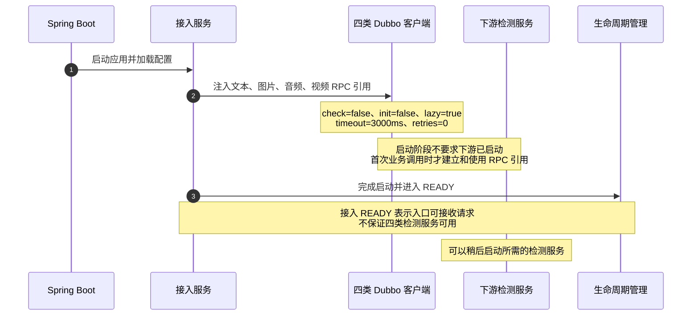
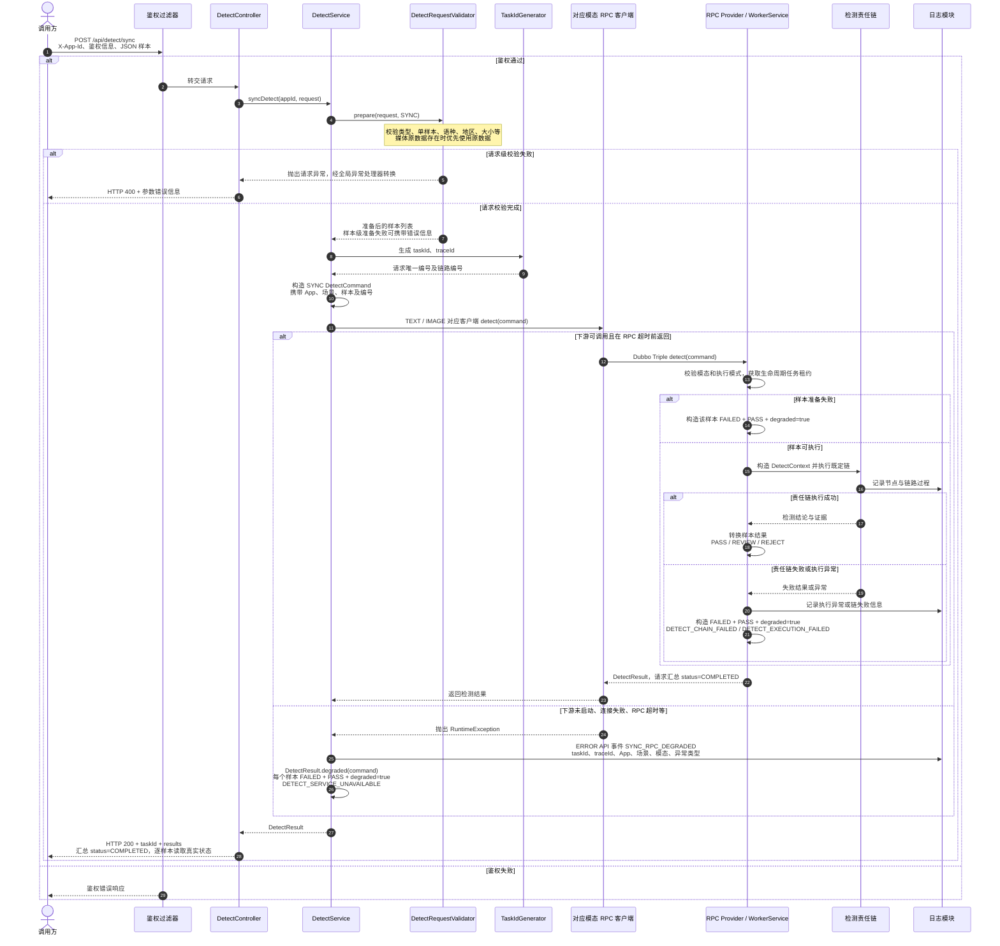
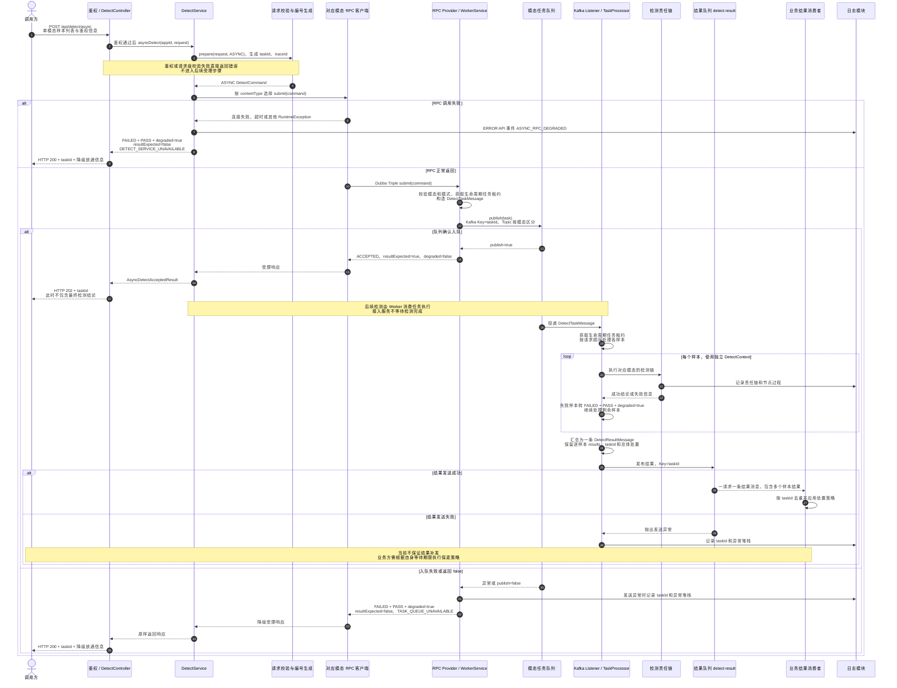

# 接入、检测与降级放通时序图

本文根据当前代码绘制，涵盖服务启动、同步检测、异步受理及结果消息。`PASS` 表示处置建议；降级时仍使用 `FAILED` 和 `degraded=true` 表明检测没有成功完成。

## 1. 接入服务独立启动

上述图只说明下游 RPC 可用性不会阻止接入启动；接入自身配置、端口及其他依赖仍需满足启动条件。

## 2. 同步检测及 RPC 降级

同步接口仅支持文本、图片单样本。鉴权与请求级校验失败返回错误，不进入 RPC 降级放通分支。

`COMPLETED` 仅表示请求处理结束。调用方需读取 `results` 内的 `status`、`action`、`degraded` 和错误码，不能仅凭 HTTP 200 或汇总状态判断检测成功。入口当前记录 RPC 异常类型；Worker 的执行异常日志包含异常堆栈。

## 3. 异步受理、执行与结果消息

异步接口支持文本、图片、音频、视频；文本和图片可在一个请求中包含多样本。只有任务队列确认入队，服务才返回 `resultExpected=true`。

本地 `logging` 任务队列不实际入队，会返回 `false`，因此异步接口按 `TASK_QUEUE_UNAVAILABLE` 降级。启用真实 Kafka 才能形成图中的任务消费与结果投递过程。

## 4. 降级返回字段对照

| 场景 | HTTP | 状态 | 处置 | 降级标记 | 后续结果预期 |
| --- | --- | --- | --- | --- | --- |
| 同步 RPC 不可用 | 200 | 请求汇总 COMPLETED，样本 FAILED | 样本 PASS | 样本 true | 不适用 |
| 异步 RPC 不可用 | 200 | FAILED | PASS | true | false |
| 异步任务入队失败 | 200 | FAILED | PASS | true | false |
| 异步任务入队成功 | 202 | ACCEPTED | 受理时为 null | false | true |

异步 RPC 超时具有不确定性：下游可能已经入队，但入口没有收到受理响应。因此 `resultExpected=false` 表示调用方无需等待，不保证绝对没有后续消息。Kafka 消费可能重复投递，结果消费者应按 `taskId` 去重。

同步 RPC 超时也不保证下游检测立即停止。当前 RPC 超时为 3000 ms，Worker 请求执行期限默认 25000 ms；二者属于不同层的等待/执行限制。本文记录当前行为，后续可另行统一超时预算。

## 代码对应

- `access-service`：`DetectController`、`DetectService`、`DetectRequestValidator`、四类 `*DetectRpcClient`。
- `detect-worker-core`：`ModalityWorkerService`、`AsyncDetectTaskProcessor`、`KafkaDetectTaskQueue`、`KafkaDetectResultQueue`。
- `detect-contract`：`DetectResult.degraded`、`DetectItemResult.degradedPass`、`AsyncDetectAcceptedResult`。
