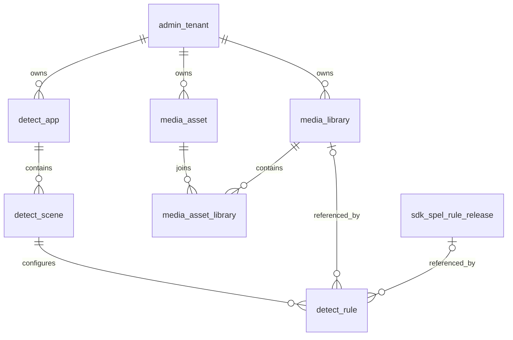

# 设计方案

## 六张表

| 表名 | 含义 | 关系 |
| --- | --- | --- |
| media_library | 媒资库，组织同类型样本及其用途 | 一个库有多个媒资关联 |
| media_asset | 媒资，保存名称、内容类型、摘要和准备状态 | 一份媒资可以加入多个库 |
| media_asset_library | 媒资与媒资库关联及库内标注 | 连接媒资和媒资库 |
| detect_rule | 场景内检测规则，指定引擎、参数和命中动作 | 属于一个场景，可引用一个媒资库或一条 SpEL 已发布规则 |
| detect_app | 接入应用，定义请求 App ID 及凭证引用 | 一个 App 有多个场景 |
| detect_scene | App 内的业务场景 | 一个场景有多个检测规则 |



## App 与场景

`detect_app.id` 是数据库内部主键，`detect_app.app_id` 是客户端请求中的字符串标识，例如 `demo-app`。外部 App ID 全局唯一，使接入服务能够先通过 `X-App-Id` 定位租户，再校验对应凭证。

场景按 App 归属，例如同一个 App 下有 `comment`、`profile`、`live-chat`。场景通过 `(tenant_id, app_record_id, scene_code)` 定位。第一版不共享同一条场景记录给多个 App；后续确有共享策略需求时再引入可复用策略和 App-场景授权关联。

App 表只保存 `credential_ref`，引用服务端环境配置或 Secret 管理中的凭证。现有开发阶段仍可使用环境变量；不会把密钥明文搬到 MySQL，也不要求先搭建 STS。URL 鉴权路由继续由现有鉴权配置负责，App 表不复制这套规则。

## 媒资与媒资库

媒资是一份内容，媒资库是一组内容。一个媒资库限定一种类型 `TEXT/IMAGE/AUDIO/VIDEO`，防止文本哈希规则误绑定图片库。库用途分为 `BLOCKLIST`、`ALLOWLIST`、`TESTSET`；测试集不能作为线上匹配库使用。

例如一张图片的内容摘要对应一条 `media_asset`，同时加入“图片违规样本库”和“图片回归测试集”，产生两条 `media_asset_library`。媒资摘要记录复用，标签和备注分别保存在关联表里。

哈希计算以内容为依据：文本使用检测服务约定的归一化文本 SHA-256；二进制使用原始字节 SHA-256。记录 `hash_version`，例如 `text-normalize-v1`、`raw-bytes-v1`。唯一键包含租户、类型、哈希版本及摘要，避免混淆不同归一化算法。URL、文件名、临时签名地址不作为内容去重依据。

用户确认不需要存储引用、MIME、大小、时长、宽、高六个字段，V9 未创建这些列。媒资表仅记录样本名称、类型、摘要、哈希版本、准备状态和备注；正文存储与检索由后续需求单独设计。保留原 `storage_status` 列名表示样本准备状态，不能仅凭此字段断言文件已存入某个存储系统。

媒资库是人工维护的持久样本目录；Redis 是检测过程中的违规结果缓存，二者分别管理。常规检测不会自动将所有请求样本入库，只有明确的上传、标注或样本收录操作才创建媒资。

## 检测规则与 SpEL

`detect_rule` 表达业务检测配置，例如“评论文本匹配违规样本库”“正则命中联系方式后复审”“异步文本调用大模型”。`sdk_spel_rule_draft/release` 管理表达式编辑、校验、发布；两者职责不同。

规则引擎类型为 `KEYWORD/REGEX/MEDIA_HASH/SPEL/LLM`。关键词和正则参数保存在经类型校验的 JSON；样本哈希规则引用 `media_library_id`；SpEL 规则引用 `spel_release_id` 和快照内的字符串 `spel_rule_id`。引用的是不可变发布版本，不能直接引用可变草稿。表达式正文不再复制到 `detect_rule.parameters_json`。

一条规则只适用一种内容类型，`execution_mode` 为 `BOTH/SYNC/ASYNC`。大模型规则必须是 `ASYNC`。规则优先级用于对应节点内的规则排序，不改变启动时组装的责任链节点顺序；业务引擎与节点对应关系由代码维护。第一版只开放当前已实现的引擎与内容类型组合，其余配置在保存/发布时拒绝。

对于 SPEL，命中动作和标签以所引用发布快照的属性为准，新表对应动作/标签列置空，避免同时配置两个互相冲突的结果来源。其他引擎使用新表的 `on_hit_action` 和风险标签。实施时需要增加按发布版本和规则标识执行的适配，现有运行代码尚未提供这条业务引用链路。已有 SpEL 的 `scene` 是检测服务加载分类，不作为这里的业务 `scene_code`；绑定时还需校验表达式输入与当前内容类型兼容。

`on_hit_action` 决定命中处置，多个节点最终聚合沿用现有拒绝优先逻辑。允许库命中只作为放通建议，不抵消其他节点的违规结论。`BLOCKLIST` 样本规则只允许 `REJECT/REVIEW`，`ALLOWLIST` 只允许 `PASS`，`TESTSET` 不允许参与在线规则。

## 运行链路

```text
X-App-Id → App 身份与租户 → 当前 App 的 sceneCode
         → 按 contentType / SYNC、ASYNC 筛选有效规则
         → 执行既定责任链中的对应检测节点
         → 返回同步结果或异步受理/结果 MQ
```

这六张表已在本轮通过 V9 创建，当前运行代码尚未读取它们。后续业务接入时，接入服务使用内存中的 App/场景配置，检测服务使用内存规则快照，不在每个检测请求中同步查询 MySQL。

初期数据量小时，可启动全量加载并定时全量校验后原子替换快照。通用热加载框架可复用，但不能直接把 `updated_at` 或单行 `version` 当成全局无遗漏增量游标。若需要可靠增量和多表一致发布，应另行设计带单调游标的发布/变更记录及完整快照；现有 `sdk_spel_rule_release.release_id` 只覆盖 SpEL 发布，不能覆盖这六张表的所有变更。删除与停用必须进入下一份快照，刷新失败沿用上一份可用快照。

## 隔离与约束

所有关联均校验同租户。新表中为被引用对象添加 `(tenant_id, id)` 唯一约束，以 `(tenant_id, 引用ID)` 复合外键避免跨租户关联；不配置级联删除。审计操作人不建立用户外键，保留系统 `0` 及历史用户删除后的引用。

六张表使用 `version` 乐观锁、`enabled` 状态和 `deleted` 软删除。唯一键不包含 `deleted`：编码、媒资摘要和关联对保留唯一，重复添加已删除记录时恢复原记录并更新审计，而不是重复插入。这样规避 `(业务键, deleted)` 在多次删除/重建时的冲突。

被有效规则引用的 App、场景、媒资库、SpEL 版本不能物理删除。关联跨租户、样本类型不匹配、不可用库、未发布 SpEL 规则、同步 LLM 配置在写入及快照构建阶段均需验证。

## 示例

租户 1 的 `demo-app` 创建场景 `comment`，配置两条 TEXT 规则：优先级 10 的 `MEDIA_HASH` 规则引用“文本违规样本库”，优先级 20 的 `SPEL` 规则引用已有发布快照中的 `text.contact.review`。同一场景也可以添加 IMAGE 规则，按请求类型筛选执行。样本库中每份内容只存一条媒资，各库通过关联记录组织自己的标注。

## 后续实施

本轮新增并执行 V9 迁移，保留已有 V1 到 V8。后续数据库操作继续放在 `config-data` SDK 的 model/service/mapper 分层中；App 凭证解析、场景授权、管理接口与热加载读取按后续需求实现。当前管理台和检测入口尚未接入新表。
