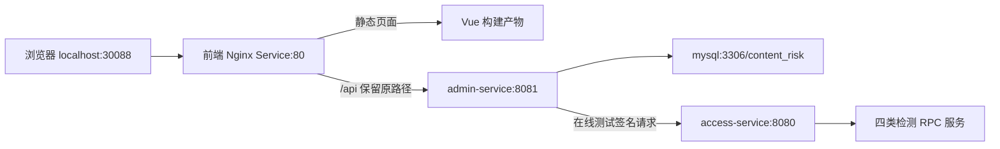

# 设计

前端以独立上下文 `study-console-web` 构建，避免根目录 `.dockerignore` 排除源码。Docker 多阶段构建通过 Node 24 生成静态产物，以 Nginx 运行；构建环境固定 `VITE_ENABLE_MOCK=false` 和相对路径 `/api`。Docker 环境变量不能在运行期重新配置已打包的 Vite 页面。

本地脚本优先选择已有的 Node 24 或 Node 22 镜像（Node 22 需满足项目要求的 22.12 及以上），以及已有 Nginx Alpine 镜像，避免无必要的下载。可使用 `ConsoleNodeImage`、`ConsoleNginxImage` 参数显式指定；发布流水线使用 Dockerfile 默认基础镜像。

`console.yaml` 增加两个 Deployment 和 Service。管理服务复用现有数据库 ConfigMap 与密码 Secret；引导管理员密码单独保存为 `ADMIN_BOOTSTRAP_PASSWORD`。在线测试凭证引用已有 `AUTH_APP_ID/AUTH_APP_SECRET`，访问地址为集群内 `http://access-service:8080`。

共享 ConfigMap 的检测文件根目录不适用于没有样本 PVC 的管理服务；管理容器覆盖为 `/tmp/admin-detection-files`，供基础 SDK 初始化使用，不参与检测文件共享。

接入服务负责 Flyway 迁移。管理服务 initContainer 等待接入服务 READY 后启动，避免空库创建管理员时缺表。管理服务使用现有生命周期探针和摘流接口；前端探针检查 `/healthz`。前端健康不代表管理 API 可用，部署脚本分别等待两个工作负载。

前端使用 NodePort 30088，管理 API 仅暴露为 ClusterIP。登录和 API 都走前端同一地址，避免浏览器跨域配置。首次引导只在租户没有用户时创建管理员，后续部署不会重置用户密码。

发布流水线构建前端镜像及上传静态产物，沿用现有 `push:false` 语义；本需求不发布到镜像仓库。提交 CI 增加前端 lint、测试和构建。
